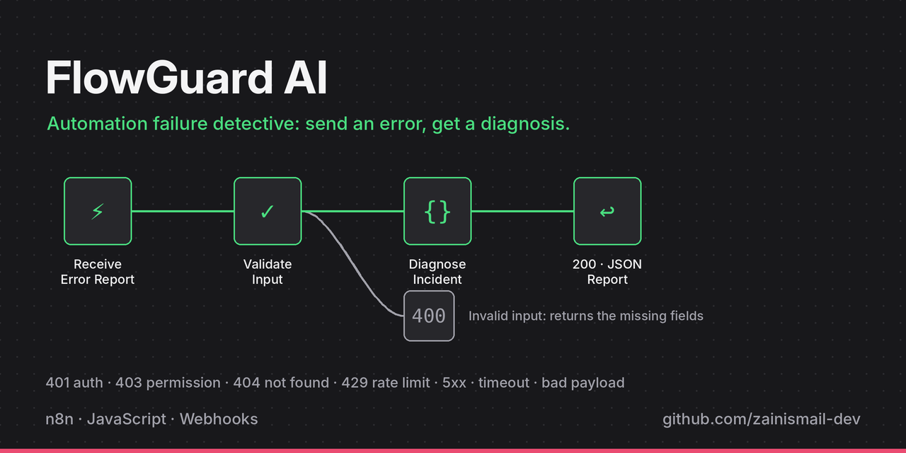
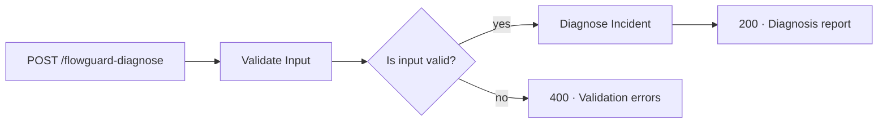

# FlowGuard AI — Automation Failure Detective




FlowGuard AI is an n8n workflow that diagnoses failed automations. Send it an error report through a webhook and it validates the input, classifies the failure, and returns a structured JSON diagnosis with a likely cause, severity, and recommended next steps.

It is designed for teams running integrations (e-commerce, CRM, payment and SaaS sync workflows) who want a consistent first-pass triage instead of reading raw error logs every time something breaks.

---

## Contents

- [How it works](#how-it-works)
- [Quick start](#quick-start)
- [API reference](#api-reference)
- [Diagnosis rules](#diagnosis-rules)
- [Testing](#testing)
- [Limitations](#limitations)
- [Roadmap](#roadmap)

---

## How it works



| Step | n8n node | What it does |
|---|---|---|
| 1 | **Receive Error Report** | Webhook that accepts `POST` requests |
| 2 | **Validate Input** | Checks required fields, validates `http_status`, trims and length-limits text |
| 3 | **Is Input Valid?** | Routes valid reports to diagnosis, invalid ones to an error response |
| 4 | **Diagnose Incident** | Applies the classification rules below |
| 5 | **Respond 200 / 400** | Returns the diagnosis or a list of validation errors |

---

## Quick start

**Requirements:** an n8n instance (self-hosted or n8n Cloud).

1. Download [`FlowGuard_AI_Import.json`](FlowGuard_AI_Import.json).
2. In n8n, open **Workflows → Import from File** and select the file.
3. Open the workflow and click **Execute workflow** (test mode), or **Activate** it for production.
4. Copy the webhook URL from the **Receive Error Report** node and send it a request:

```bash
curl -X POST "https://<your-n8n-host>/webhook-test/flowguard-diagnose" \
  -H "Content-Type: application/json" \
  -d '{
    "platform": "Shopify",
    "workflow_name": "Order Sync",
    "error_message": "Invalid API access token",
    "http_status": 401
  }'
```

> Use `/webhook-test/` while testing in the editor and `/webhook/` once the workflow is active.

---

## API reference

### Request

`POST /flowguard-diagnose` · `Content-Type: application/json`

| Field | Type | Required | Notes |
|---|---|---|---|
| `platform` | string | ✅ | System where the failure happened, e.g. `Shopify`, `HubSpot` |
| `error_message` | string | ✅ | Error text returned by the failing step |
| `http_status` | integer | | Must be between 100 and 599 if provided |
| `incident_id` | string | | Auto-generated as `FG-<timestamp>` if omitted |
| `workflow_name` | string | | Name of the failing workflow |
| `expected_result` | string | | What should have happened |
| `actual_result` | string | | What actually happened |

Text fields are trimmed and capped at 1,000 characters.

### Success response — `200 OK`

```json
{
  "incident_id": "FG-1729931234567",
  "platform": "Shopify",
  "workflow_name": "Order Sync",
  "category": "authentication",
  "severity": "high",
  "likely_cause": "The credential may be invalid, expired, revoked, or incorrectly configured.",
  "evidence": ["HTTP 401 was reported"],
  "confirmed_facts": [
    "Platform reported: Shopify",
    "Error reported: Invalid API access token",
    "HTTP status reported: 401"
  ],
  "recommended_actions": [
    "Reconnect or re-authenticate the credential",
    "Check whether the token expired or was rotated",
    "Confirm the correct credential is used"
  ],
  "confidence": "high",
  "impact_verified": false,
  "disclaimer": "This is a rule-based diagnosis, not a confirmed root cause.",
  "status": "diagnosed",
  "diagnosed_at": "2026-10-26T06:54:00.000Z"
}
```

### Validation error — `400 Bad Request`

```json
{
  "status": "invalid_request",
  "error": "Missing or invalid required fields",
  "details": ["platform is required"],
  "required_fields": ["platform", "error_message"]
}
```

---

## Diagnosis rules

Rules are evaluated in order; the first match wins.

| Trigger | Category | Severity | Confidence |
|---|---|---|---|
| HTTP 401 | `authentication` | high | high |
| HTTP 403 | `permission` | high | high |
| HTTP 404 | `not_found` | medium | high |
| HTTP 429 | `rate_limit` | medium | high |
| HTTP 5xx | `server_error` | high | medium |
| Message mentions *timeout / timed out / ETIMEDOUT* | `timeout` | medium | medium |
| Message mentions *missing / required field / invalid payload* | `invalid_payload` | medium | medium |
| Anything else | `unknown` | low | low |

Every response separates **confirmed facts** (what the caller reported) from the **likely cause** (FlowGuard's inference), so a guess is never presented as a verified root cause.

---

## Testing

| Test | Method | Result |
|---|---|---|
| HTTP 429 rate-limit diagnosis | Mock data in n8n | ✅ Classified as `rate_limit` |
| HTTP 401 authentication diagnosis | Mock data in n8n | ✅ Classified as `authentication` |
| End-to-end request | Live `POST` via Hoppscotch to the test webhook | ✅ Structured diagnosis returned |

---

## Tech stack

**n8n** (workflow orchestration) · **JavaScript** (validation and rules in Code nodes) · **Webhooks / HTTP** · **JSON** · **Hoppscotch** (API testing)

---

## Limitations

- Diagnosis is rule-based; no AI model is used yet.
- Suggested causes are inferred, not independently verified.
- Incidents are not stored between requests.
- No dashboard or authentication on the webhook.
- Does not monitor Shopify, CRM or other systems on its own — failures must be reported to it.

## Roadmap

- [ ] Persist incident history (database or Google Sheets)
- [ ] Optional LLM-assisted diagnosis for the `unknown` category
- [ ] Webhook authentication (header token)
- [ ] Dashboard for recurring-error analysis
- [ ] Automated test suite for every rule

---

## Author

**Zain Ismail** — [GitHub](https://github.com/zainismail-dev)
